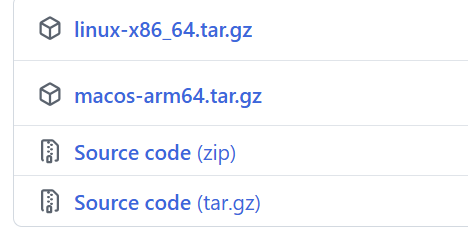
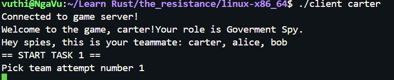

# About this Resistance game

---

## 1. How to run this game
1. Download the release

Open my GitHub repository's Releases page and download the archive for your operating system. If you're on Ubuntu, choose the `linux-x86_64.tar.gz`.




2. Extract the archive
Extract it into a folder. It should contain both executables:

```
game/
├── server
└── client
```

3. Start the server
Open a terminal in the extracted folder and run the server.

```bash
chmod +x server
./server
```

4. Start the clients
Open a second terminal in the same folder and run:

```bash
chmod +x client
./client client_name
```

You can put any client_name you like. Enjoy the game.

## 2. The game rules

1. Each member will be randomized to be government spy, assassin, merlin, or resistance operative.
- The spies will know each other.
- Merlin knows the spies



2. Everyone take turn to be the captain. The captain choose a team of 3 people they want to go on the quest.
- Everyone start discussing if they agreed on the quest team.
- If the majority agree, the quest team start the quet.
- If not, the leader pick again and everyone vote again. 5 failed pick team attempt will guarantee the spies to win.

3. The quest team vote anonymously if they want the quest to succeed or not.
- The quest succeed if >= 2 quest team member vote the quest to succeed, fail otherwise.

4. Repeat step 2 until all 5 quests completed.

5. Assassin takes a shot to kill Merlin. If they guess correctly who Merlin is, the Goverment Spy wins.

6. If not, the Resistance team win if >= 3/5 quests succeeds, the Government Spy wins otherwise.